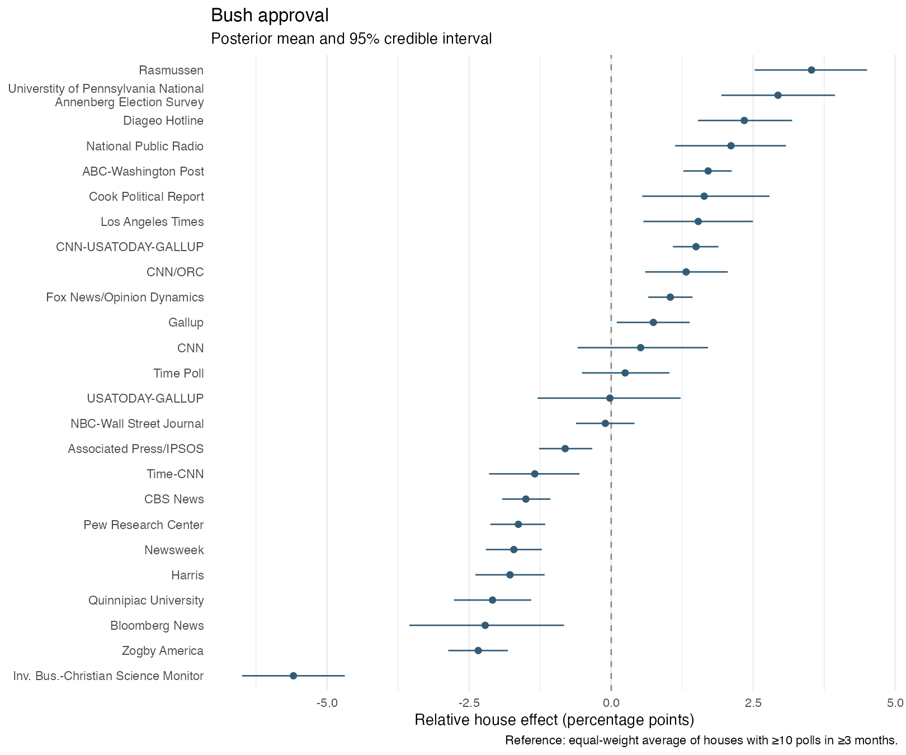
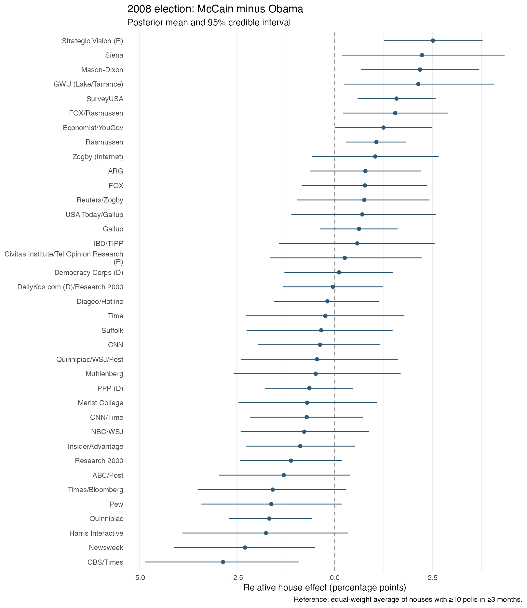

# The House Always Wins: House Effects in Polling

How much do polling organizations differ when measuring the same
political outcome at comparable times and places? This project estimates
**relative house effects** from historical Bush approval polls and 2008
presidential election polls. The estimates describe these datasets and
periods, not the current performance of polling organizations.

Rasmussen’s estimated Bush-approval house effect is **+3.5 pp (95%
credible interval +2.5 to +4.5)**. Its estimated effect on the
McCain-minus-Obama margin is **+1.1 pp (95% credible interval +0.3 to
+1.8)**. The reference in each analysis is the equal-weight average of
houses with at least ten usable polls in at least three calendar months.
Positive values mean higher Bush approval or a more Republican election
margin than that reference.

These are differences from other pollsters, not errors against known
public opinion. Polling consensus can itself be wrong. A house effect
includes the organization’s population screens and other practices; it
does not identify their individual contributions or establish
intentional bias.

Results can depend on sample availability and modeling choices.
Rasmussen’s sample-size-weighted approval estimate is **+0.1 pp (95%
credible interval -2.4 to +2.7)**, retaining only 2 of its 23 usable
polls. This sensitivity changes both the sample and the error model, so
it cannot isolate the effect of weighting.

## Bush approval

The analysis uses 1635 polls, covering 2001-01-25 through 2008-10-09.



| House | Effect (pp) | 95% interval | Polls | Support |
|:---|---:|:---|---:|:---|
| ABC-Washington Post | 1.7 | 1.3 to 2.1 | 151 | supported |
| Associated Press/IPSOS | -0.8 | -1.3 to -0.3 | 107 | supported |
| Bloomberg News | -2.2 | -3.6 to -0.8 | 11 | supported |
| CBS News | -1.5 | -1.9 to -1.1 | 145 | supported |
| CNN | 0.5 | -0.6 to 1.7 | 15 | supported |
| CNN-USATODAY-GALLUP | 1.5 | 1.1 to 1.9 | 201 | supported |
| CNN/ORC | 1.3 | 0.6 to 2.1 | 41 | supported |
| Cook Political Report | 1.6 | 0.5 to 2.8 | 14 | supported |
| Diageo Hotline | 2.3 | 1.5 to 3.2 | 31 | supported |
| Fox News/Opinion Dynamics | 1.0 | 0.7 to 1.4 | 156 | supported |
| Gallup | 0.7 | 0.1 to 1.4 | 57 | supported |
| Harris | -1.8 | -2.4 to -1.2 | 69 | supported |
| Inv. Bus.-Christian Science Monitor | -5.6 | -6.5 to -4.7 | 31 | supported |
| Los Angeles Times | 1.5 | 0.6 to 2.5 | 23 | supported |
| NBC-Wall Street Journal | -0.1 | -0.6 to 0.4 | 75 | supported |
| National Public Radio | 2.1 | 1.1 to 3.1 | 20 | supported |
| Newsweek | -1.7 | -2.2 to -1.2 | 101 | supported |
| Pew Research Center | -1.6 | -2.1 to -1.2 | 98 | supported |
| Quinnipiac University | -2.1 | -2.8 to -1.4 | 46 | supported |
| Rasmussen | 3.5 | 2.5 to 4.5 | 23 | supported |
| Time Poll | 0.2 | -0.5 to 1.0 | 40 | supported |
| Time-CNN | -1.3 | -2.1 to -0.6 | 32 | supported |
| USATODAY-GALLUP | 0.0 | -1.3 to 1.2 | 13 | supported |
| Universtity of Pennsylvania National Annenberg Election Survey | 2.9 | 1.9 to 3.9 | 24 | supported |
| Zogby America | -2.3 | -2.9 to -1.8 | 96 | supported |

## 2008 presidential election

The analysis uses 2329 polls, covering 2007-01-02 through 2008-11-03.
National polls and state polls have separate geographic levels and
trends. The outcome is McCain support minus Obama support, without
renormalizing away other candidates or undecided respondents. A
two-point effect on this margin is not a two-point effect on one
candidate’s vote share.



| House | Effect (pp) | 95% interval | Polls | Support |
|:---|---:|:---|---:|:---|
| ABC/Post | -1.3 | -3.0 to 0.4 | 18 | supported |
| ARG | 0.8 | -0.6 to 2.2 | 92 | supported |
| CBS/Times | -2.9 | -4.8 to -0.9 | 11 | supported |
| CNN | -0.4 | -2.0 to 1.2 | 17 | supported |
| CNN/Time | -0.7 | -2.2 to 0.7 | 51 | supported |
| Civitas Institute/Tel Opinion Research (R) | 0.3 | -1.7 to 2.2 | 11 | supported |
| DailyKos.com (D)/Research 2000 | 0.0 | -1.3 to 1.2 | 74 | supported |
| Democracy Corps (D) | 0.1 | -1.3 to 1.5 | 23 | supported |
| Diageo/Hotline | -0.2 | -1.6 to 1.1 | 30 | supported |
| Economist/YouGov | 1.2 | 0.0 to 2.5 | 36 | supported |
| FOX | 0.8 | -0.8 to 2.4 | 16 | supported |
| FOX/Rasmussen | 1.5 | 0.2 to 2.9 | 47 | supported |
| GWU (Lake/Tarrance) | 2.1 | 0.2 to 4.1 | 12 | supported |
| Gallup | 0.6 | -0.4 to 1.6 | 68 | supported |
| Harris Interactive | -1.8 | -3.9 to 0.3 | 10 | supported |
| IBD/TIPP | 0.6 | -1.4 to 2.6 | 12 | supported |
| InsiderAdvantage | -0.9 | -2.3 to 0.5 | 37 | supported |
| Marist College | -0.7 | -2.5 to 1.1 | 17 | supported |
| Mason-Dixon | 2.2 | 0.7 to 3.7 | 39 | supported |
| Muhlenberg | -0.5 | -2.6 to 1.7 | 10 | supported |
| NBC/WSJ | -0.8 | -2.4 to 0.9 | 13 | supported |
| Newsweek | -2.3 | -4.1 to -0.5 | 14 | supported |
| PPP (D) | -0.6 | -1.8 to 0.5 | 68 | supported |
| Pew | -1.6 | -3.4 to 0.2 | 13 | supported |
| Quinnipiac | -1.7 | -2.7 to -0.6 | 98 | supported |
| Quinnipiac/WSJ/Post | -0.5 | -2.4 to 1.6 | 20 | supported |
| Rasmussen | 1.1 | 0.3 to 1.8 | 413 | supported |
| Research 2000 | -1.1 | -2.4 to 0.2 | 45 | supported |
| Reuters/Zogby | 0.8 | -1.0 to 2.4 | 22 | supported |
| Siena | 2.2 | 0.2 to 4.3 | 15 | supported |
| Strategic Vision (R) | 2.5 | 1.3 to 3.8 | 47 | supported |
| Suffolk | -0.3 | -2.3 to 1.5 | 17 | supported |
| SurveyUSA | 1.6 | 0.6 to 2.6 | 329 | supported |
| Time | -0.2 | -2.3 to 1.8 | 10 | supported |
| Times/Bloomberg | -1.6 | -3.5 to 0.3 | 13 | supported |
| USA Today/Gallup | 0.7 | -1.1 to 2.6 | 13 | supported |
| Zogby (Internet) | 1.0 | -0.6 to 2.7 | 84 | supported |

The tables show houses meeting the reference coverage rule, without
filtering on statistical significance. The complete [approval
estimates](results/approval_estimates.csv) and [election
estimates](results/election_estimates.csv) include sparse houses, their
intervals, coverage dates, and overlap measures. In the CSVs, `estimate`
and `sd` are the posterior mean and standard deviation; `lower` and
`upper` are the 95% interval bounds. Sparse estimates depend more
heavily on partial pooling. Intervals are marginal credible intervals,
not simultaneous guarantees for all houses or a ranking of accuracy.

## Model and checks

| Model | Role | Main tradeoff |
|----|----|----|
| House and geography-month fixed effects | Descriptive benchmark | Transparent within-cell comparisons; sparse or disconnected houses are poorly identified |
| Bayesian Student-t model | Published estimates | Partial pooling and joint uncertainty; depends on time, geography, and dependence assumptions |
| Gaussian model with approximate sampling variances | Sensitivity analysis | Uses reported sample sizes; excludes missing sizes and assumes unobserved design effects away |

Separate Bayesian Student-t models combine partially pooled house
intercepts, smooth time trends, and correlated errors within each house
and fortnight. Approval includes an explicit September 11, 2001 break so
the trend does not spread the abrupt change into earlier polls. Election
models also include geography intercepts and partially pooled cubic
spline deviations by geography. The model uses reported percentage-point
outcomes, not invented respondent-level counts. Missing sample sizes
therefore do not remove polls from the primary analysis.

House effects are constant within each historical dataset. Differences
in question wording, survey mode, sponsorship, and populations may
remain inside these estimates. Time trends approximate opinion over
fieldwork using its midpoint. Within-fortnight correlation addresses
some dependence but cannot recover unobserved respondent overlap.
Limited comparison support is measured using shared geography-month
cells and explicitly flagged.

The [model report](docs/audit.md) documents data handling, fixed-effects
benchmarks, sample-size and screen adjustments, alternate time trends,
four-week dependence blocks, nonoverlapping fieldwork samples,
influential-house exclusions, posterior predictive checks, and
simulated-data recovery. National-only and McCain-support analyses are
also provided. These are sensitivity analyses of historical relative
effects, not election forecasts.

Forward prediction is poor for approval: training through 2006-10-22
gives 23.5-point RMSE on the later polls, with 84.5% coverage from
nominal 95% predictive intervals. These are retrospective adjustment
models; the approval model should not be used to forecast opinion.

## Reproduce

Use R 4.6 or newer, a working C++ toolchain, Make, and Pandoc. The
recorded run uses R 4.6.0, `brms` 2.23.0, and CmdStan 2.40.0. Dependency
versions are recorded in `renv.lock`.

``` sh
make setup
make all
```

`make setup` restores R packages into `.r-library` and installs CmdStan
2.40.0 into the ignored project cache. An explicit `CMDSTAN` environment
variable can select another installation. Full Bayesian fits and
sensitivity runs can take many hours; cached fits are reused when their
data and statistical model match. To change sampling controls, iteration
counts, or software versions for an existing fit, remove its named
`.rds` file from `cache/` before refitting.

``` sh
make test
make lint
make ci-docker
make render
```

`make ci-docker` runs tests, lint, and published-artifact checks in the
standard `rocker/verse:4.6.0` image. The GitHub workflow additionally
fits a simulated Bayesian model. `make render` rebuilds this README and
the audit report from saved results; analytical numbers are not
maintained by hand. Fits are cached during estimation and can be deleted
after the reports and checks finish. CSV estimates, generated Stan
programs, diagnostics, and session information are committed in
`results/`.

## Data

These data were collected in 2007–2008 to examine house effects and
differences in polling practices. The original sources included
PollingReport.com and Pollster.com. This repository retains the original
[Bush approval data](data/bushfav_merged.csv) and [election
data](data/collapsed%20polls_pollster.csv).

The cleaned [poll-level data](results/polls.csv) retain source rows and
flag observations excluded from estimation. The election CSV has two
source columns named `n`; the importer preserves both under distinct
names and checks their agreement. Unverified dates are excluded rather
than silently repaired. The audit explains what can and cannot be
verified from these historical files.

The original descriptive figures remain in `figs/approve_rasmussen.png`
and `figs/mccain_rasmussen.png`; they are not the adjusted house-effect
estimates.

Released under [CC BY
2.0](https://creativecommons.org/licenses/by/2.0/). Corrections and
additional source documentation are welcome through issues or pull
requests.
