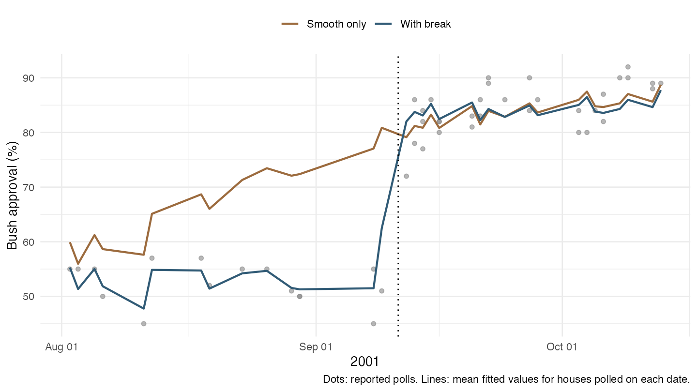
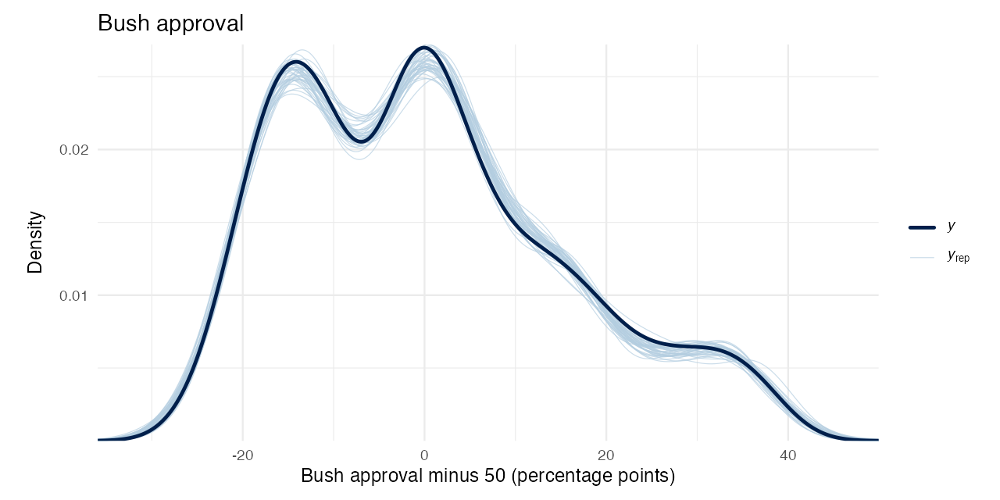
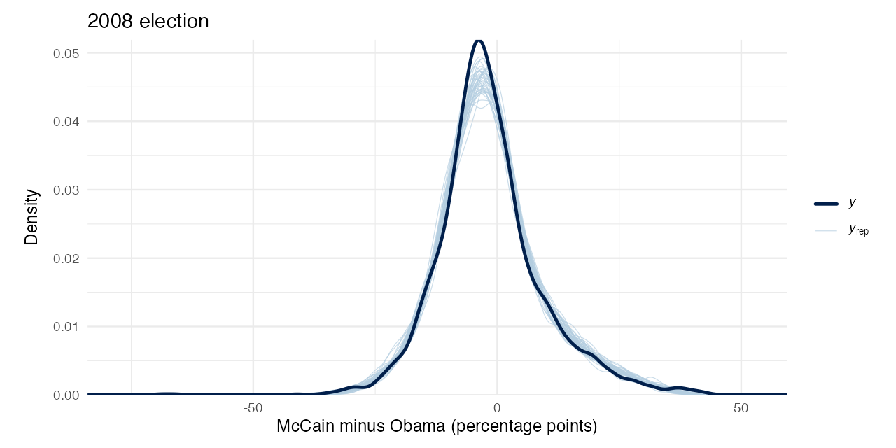

# Models and validation

The original analysis plotted Rasmussen and other polls with separate
smooth curves. It did not estimate adjusted house coefficients. Its
approval comparison is strongly affected by differences in polling
dates: the raw Rasmussen gap is -8.46 percentage points, compared with
3.84 after adjusting for time in a descriptive spline regression. The
quantities answer different questions; the latter is not a correction to
the former’s arithmetic.

The original election plot pooled states and national polls. Geography
is a necessary comparison dimension, although adding geography to the
time-adjusted Rasmussen-versus-rest regression changes that particular
McCain-support coefficient only slightly. The comparison below uses
20-degree-of-freedom natural splines and is distinct from the primary
Bayesian models.

| dataset | original_raw_gap | cleaned_raw_gap | time_adjusted_gap | time_geography_adjusted_gap |
|:---|---:|---:|---:|---:|
| approval | -8.46 | -8.36 | 3.84 | 3.84 |
| election | 1.45 | 1.45 | 1.85 | 1.85 |

## Quantities being estimated

| Analysis | Unit and outcome | Comparison | Interpretation |
|----|----|----|----|
| Approval | Poll, Bush approval percentage | Other houses at comparable dates | Historical relative approval house effect |
| Election | Poll, McCain minus Obama percentage points | Other houses at comparable dates and geographies | Historical relative partisan-margin house effect |
| Sample-size sensitivity | Poll, same outcome with approximate sampling variance | Restricted to reported positive sample sizes | A different available-data sample and precision model |

The reference is the equal-weight mean of qualifying houses, separately
for each dataset. The reference mean is subtracted within every
posterior draw, propagating its uncertainty into all reported contrasts.
Absolute accuracy cannot be identified without an external opinion
benchmark. Election-day results would measure a different target from
opinion months before voting. The interpretation is associational: no
intervention or random assignment identifies the effects of particular
polling practices.

## Data integrity

| Measure                   | approval   | election   |
|:--------------------------|:-----------|:-----------|
| source_polls              | 1644       | 2332       |
| usable_polls              | 1635       | 2329       |
| houses                    | 29         | 189        |
| excluded_polls            | 9          | 3          |
| missing_sample_size       | 388        | 71         |
| unknown_screen            | 1590       | 0          |
| first_date                | 2001-01-25 | 2007-01-02 |
| last_date                 | 2008-10-09 | 2008-11-03 |
| exact_duplicate_rows      | 0          | 0          |
| duplicate_survey_keys     | 0          | 0          |
| overlapping_polls_removed | 48         | 8          |

Original source files are unchanged. Row identifiers are the original
CSV line numbers, including the header. Explicit joins declare their
cardinality, and tests enforce row accounting and the signs and units of
derived outcomes.

The election source has duplicate `n` headers. The first contains the
reported sample size and population text; the second is a derived
numeric field. The importer assigns distinct names and parses the source
text. 71 polls report a population label without a sample size; their
derived zero becomes unknown. The national YouGov row reports 31,148
respondents in its text but 3,114 in its derived column. The text is
retained as the source value; this is an internal reconciliation, not
independent verification of the original poll.

Election dates are reconstructed from the original single-day,
same-month, or cross-month strings. Derived years such as `208`, zero
months, and conflicting day fields are not used for estimation. The
approval week field also disagrees with recorded dates by more than five
weeks in 13 rows, including a Rasmussen row differing by about a year.
The primary analysis gives precedence to dates; a sensitivity fit
excludes these conflicts. This tests the consequence of that precedence
rule without claiming independent verification of either source field.

Three election date strings run backwards and remain unresolved.
Approval exclusions comprise seven incomplete date intervals and two
unverified fieldwork intervals longer than 30 days. The latter are 44
and 239 days; using their midpoints could misplace a poll by months.
This explicit exclusion rule does not establish the true dates.
Exclusions are flagged in the cleaned data. A sensitivity fit restores
the two long intervals using their recorded midpoints to show the
consequence of excluding them.

Missing approval screen indicators and `(lv = 0, rv = 0)` are treated as
unknown because the file does not establish an adult-population
definition. Outcome categories such as `neither`, `unsure`, and `dk` may
overlap; they are not added together or recoded to zero. The margin uses
the original percentages without two-party normalization. The data
contain no exact duplicate rows or duplicate house/geography/fieldwork
keys after cleaning. Overlapping fieldwork is retained in the primary
model and thinned in a sensitivity analysis.

House-name normalization trims whitespace and merges three
spelling/order variants: `StrategicVision (R)`, `Fox/Rasmussen`, and the
reversed Research 2000/DailyKos sponsor label. Different sponsors and
internet/telephone series otherwise remain separate. These labels are
polling series, not a verified corporate-family genealogy.

## Model specification

The response is centered at 50 for approval and zero for the election
margin. Both likelihoods use multivariate Student-t errors with an
identity link. House intercepts are normally distributed with an
estimated scale. Polls within a house and calendar fortnight form a
block with scale matrix `σ² I + τ² 11′`. Blocks are independent
conditional on the model parameters. Their covariance is the scale
matrix multiplied by `ν / (ν - 2)`. A shared normal shock and
independent normal errors, divided by a common chi-square scale within
the block, give this distribution. The likelihood integrates out the
block shocks analytically; predictions draw them jointly.

The custom Stan density is checked against `mvtnorm` for correlated
blocks, independent observations, and heterogeneous known sampling
variances. The common time trend uses a cubic B-spline with 60 basis
columns for approval and 15 for elections. Interior knots are evenly
spaced over fixed boundaries (2001–2009 for approval; 2007–2009 for
elections). The first basis column is omitted to identify the intercept.
Basis coefficients have normal priors with 20-point scale. Knots remain
fixed for held-out prediction.

Approval also includes a level break on September 11, 2001. For
fieldwork that crosses that date, exposure is the fraction of recorded
fieldwork days on or after September 11, assuming uniform interviewing
across those days. This approximates the abrupt common change while
keeping the smooth trend for other movements; it is not a causal
estimate of the event. Residual review of the smooth-only pilot found
large systematic overpredictions in several pre-event polls: the spline
had spread the later jump backwards. The explicit break addresses that
failure, and a smooth-only sensitivity fit shows its effect on house
contrasts.

| model       | polls |  rmse | maximum_absolute_residual |
|:------------|------:|------:|--------------------------:|
| Smooth only |    16 | 17.87 |                     29.85 |
| With break  |    16 |  3.34 |                     11.47 |

The remaining large residual in this window is a CNN–USA Today–Gallup
poll recorded as September 8–11 with 51% approval. Uniform exposure
assigns one quarter of its interviews to September 11. The source does
not supply interview times or daily counts, so that approximation can
overstate exposure to the post-event shift. Its recorded dates and
outcome are retained.

Basis-size and prior-scale sensitivities check the regularization of the
time trend.

Election geography intercepts have normal priors. Geography deviations
use four natural cubic spline basis columns with interior knots at
mid-2007, early-2008, and mid-2008, and boundaries at early-2007 and
early-2009. Each coefficient has its own estimated across-geography
scale; coefficients are independent a priori. National polling is one
geography, not an aggregate imposed on state polls.

Normal prior scales are 20 percentage points for intercepts and
unpenalized coefficients, 5 for group scales, and 10 for the residual
scale. Scale parameters are constrained positive. Degrees of freedom
follow two plus an exponential distribution with rate 0.1. These priors
are deliberately broad; prior predictive checks quantify mass beyond
percentage bounds. Student-t tails allow unusual observations without
deleting them. A continuous likelihood can predict outside the logical
bounds, so predictive behavior must be checked.

Each published fit uses four chains with at least 1,000 warmup and 1,000
retained iterations per chain and maximum tree depth 13. Primary fits
use `adapt_delta = 0.99`. Approval fits use a dense Euclidean metric to
accommodate correlations among trend coefficients; election fits use a
diagonal metric. Supplementary fits start at 0.95, with 0.99 and longer
chains used when diagnostics require a retry. Publication requires
E-BFMI of at least 0.3 in every chain, no divergences or tree-depth
hits, R-hat at most 1.01, and bulk and tail effective sample sizes of at
least 400 for every reported house contrast.

### approval

| min_bfmi | divergences | treedepth_hits | max_rhat | house_max_rhat | house_min_bulk_ess | house_min_tail_ess | passed |
|---:|---:|---:|---:|---:|---:|---:|:---|
| 0.816 | 0 | 0 | 1.006 | 1.003 | 4462.007 | 2797.394 | TRUE |

### election

| min_bfmi | divergences | treedepth_hits | max_rhat | house_max_rhat | house_min_bulk_ess | house_min_tail_ess | passed |
|---:|---:|---:|---:|---:|---:|---:|:---|
| 0.626 | 0 | 0 | 1.007 | 1.002 | 4787.605 | 4784.179 | TRUE |

## Benchmarks, support, and sensitivity

Unpooled least-squares benchmarks control for geography-by-month cells
(month alone for approval). A bipartite house/cell graph identifies
connected comparison components before estimating contrasts. Benchmark
estimates are centered within connected components and are
point-estimate diagnostics; they do not supply the headline uncertainty
intervals. All approval houses are connected. The election comparison
graph has one main component with 182 houses and 7 isolated houses;
those isolated comparisons rely on the Bayesian model rather than
within-cell contrasts. Rank, condition number, and maximum leverage are
saved alongside them. High leverage and weak overlap limit what the data
can establish even when the Bayesian sampler converges. The overlap flag
is descriptive: a qualifying house is labeled `supported` when at least
half its polls share a geography-month cell with another house, and
`limited overlap` otherwise. This threshold does not validate the time
trend or selection assumptions.

For Rasmussen, the month-cell benchmark and the primary smooth-trend
model compare as follows. Their time controls differ, and only the
Bayesian model partially pools house effects.

| dataset  | house     | estimate | lower | upper | benchmark |
|:---------|:----------|---------:|------:|------:|----------:|
| approval | Rasmussen |     3.53 |  2.53 |  4.50 |      3.27 |
| election | Rasmussen |     1.06 |  0.29 |  1.83 |      1.37 |

The sensitivity tables below show Rasmussen to make specification
changes easy to inspect. Complete results for every house are in the
CSVs. Each subset is compared with the primary fit recentered on the
same available reference houses. Changing the sample can change the
estimand. The McCain-only outcome differs from the margin, so its
coefficient difference is not a stability statistic.

The influential-house exclusions are:

| dataset  | specification | omitted_house             |
|:---------|:--------------|:--------------------------|
| approval | omit_large_1  | CNN-USATODAY-GALLUP       |
| approval | omit_large_2  | Fox News/Opinion Dynamics |
| approval | omit_large_3  | ABC-Washington Post       |
| election | omit_large_1  | Rasmussen                 |
| election | omit_large_2  | SurveyUSA                 |
| election | omit_large_3  | Quinnipiac                |

An exclusion of Rasmussen has no Rasmussen coefficient to report; its
effects on the remaining houses appear in the complete sensitivity file.

### approval

| specification | estimate | lower | upper | primary_estimate | difference | n_polls | n_reference |
|:---|---:|---:|---:|---:|---:|---:|---:|
| screen | 3.53 | 2.54 | 4.51 | 3.53 | 0.00 | 23 | 25 |
| flexible | 3.41 | 2.53 | 4.28 | 3.53 | -0.12 | 23 | 25 |
| nonoverlap | 3.51 | 2.53 | 4.44 | 3.53 | -0.02 | 23 | 25 |
| four_week | 3.43 | 2.41 | 4.39 | 3.53 | -0.10 | 23 | 25 |
| wider_prior | 3.53 | 2.49 | 4.51 | 3.53 | 0.00 | 23 | 25 |
| sample_size | 0.12 | -2.38 | 2.70 | 3.58 | -3.46 | 2 | 24 |
| omit_large_1 | 3.48 | 2.51 | 4.43 | 3.59 | -0.11 | 23 | 24 |
| omit_large_2 | 3.60 | 2.65 | 4.55 | 3.57 | 0.03 | 23 | 24 |
| omit_large_3 | 3.63 | 2.66 | 4.60 | 3.60 | 0.03 | 23 | 24 |
| smooth_only | 3.61 | 2.65 | 4.54 | 3.53 | 0.08 | 23 | 25 |
| long_fieldwork | 3.39 | 2.41 | 4.32 | 3.53 | -0.13 | 24 | 25 |
| date_conflicts | 3.69 | 2.69 | 4.66 | 3.53 | 0.16 | 22 | 25 |

### election

| specification | estimate | lower | upper | primary_estimate | difference | n_polls | n_reference |
|:---|---:|---:|---:|---:|---:|---:|---:|
| screen | 0.99 | 0.18 | 1.79 | 1.06 | -0.08 | 413 | 37 |
| flexible | 1.02 | 0.25 | 1.79 | 1.06 | -0.04 | 413 | 37 |
| nonoverlap | 1.09 | 0.32 | 1.85 | 1.06 | 0.03 | 412 | 37 |
| four_week | 0.88 | 0.01 | 1.76 | 1.06 | -0.18 | 413 | 37 |
| wider_prior | 1.07 | 0.30 | 1.86 | 1.06 | 0.01 | 413 | 37 |
| sample_size | 1.31 | 0.50 | 2.11 | 1.06 | 0.25 | 413 | 37 |
| omit_large_2 | 1.30 | 0.52 | 2.10 | 1.11 | 0.19 | 413 | 36 |
| omit_large_3 | 1.07 | 0.30 | 1.86 | 1.02 | 0.06 | 413 | 36 |
| national | 1.77 | 0.85 | 2.72 | 1.29 | 0.48 | 91 | 27 |
| mccain | 1.58 | 0.95 | 2.19 | 1.06 | 0.51 | 413 | 37 |

The next table reports the largest change among reference houses in each
specification. These are differences between posterior means, not tests
of statistical significance. The McCain-support outcome is excluded
because it uses a different scale from the margin.

| dataset  | specification  | house                 | difference |
|:---------|:---------------|:----------------------|-----------:|
| approval | date_conflicts | Rasmussen             |       0.16 |
| approval | flexible       | CBS News              |       0.16 |
| approval | four_week      | Rasmussen             |      -0.10 |
| approval | long_fieldwork | Rasmussen             |      -0.13 |
| approval | nonoverlap     | Time Poll             |       0.15 |
| approval | omit_large_1   | Rasmussen             |      -0.11 |
| approval | omit_large_2   | Newsweek              |      -0.08 |
| approval | omit_large_3   | Bloomberg News        |      -0.08 |
| approval | sample_size    | Rasmussen             |      -3.46 |
| approval | screen         | Quinnipiac University |      -0.17 |
| approval | smooth_only    | Bloomberg News        |      -0.46 |
| approval | wider_prior    | Bloomberg News        |      -0.06 |
| election | flexible       | NBC/WSJ               |      -0.14 |
| election | four_week      | Zogby (Internet)      |      -0.69 |
| election | national       | Quinnipiac            |       1.70 |
| election | nonoverlap     | Harris Interactive    |      -0.26 |
| election | omit_large_1   | Siena                 |      -0.70 |
| election | omit_large_2   | Research 2000         |      -0.59 |
| election | omit_large_3   | Siena                 |       0.66 |
| election | sample_size    | USA Today/Gallup      |       0.64 |
| election | screen         | Economist/YouGov      |       1.73 |
| election | wider_prior    | IBD/TIPP              |      -0.13 |

The sample-size variant uses Gaussian observation error with approximate
simple-random-sampling variances plus estimated residual error. For the
margin, the variance is
`10000 * (p_mccain + p_obama - (p_mccain - p_obama)^2) / n`; candidate
shares from the same sample are not independent. Survey design effects
and weighting are unavailable, so these are not known true standard
errors. The primary model avoids treating these approximations as exact.

## Prediction and simulation checks

### approval

| statistic | observed |  lower |  upper |
|:----------|---------:|-------:|-------:|
| mean      |     0.24 |   0.00 |   0.36 |
| sd        |    15.40 |  15.25 |  15.60 |
| minimum   |   -28.00 | -39.07 | -27.23 |
| maximum   |    42.00 |  40.35 |  49.94 |

| fraction_outside_bounds |
|------------------------:|
|                 1.4e-05 |

| lower_95 | upper_95 | fraction_outside_bounds |
|---------:|---------:|------------------------:|
|   -55.64 |    53.41 |                    0.07 |

| window_days | block_comparison   | pairs | correlation |
|------------:|:-------------------|------:|------------:|
|           7 | between fortnights |   119 |        0.20 |
|           7 | within fortnight   |   171 |        0.45 |
|          14 | between fortnights |   440 |        0.24 |
|          14 | within fortnight   |   231 |        0.35 |
|          30 | between fortnights |   919 |        0.18 |
|          30 | within fortnight   |   231 |        0.35 |
|          60 | between fortnights |  1253 |        0.14 |
|          60 | within fortnight   |   231 |        0.35 |

| cutoff | n_train | n_holdout | prediction_draws | unsupported_geography_polls | existing_period_polls | rmse | mae | mean_interval_width_95 | predictive_coverage_95 |
|:---|---:|---:|---:|---:|---:|---:|---:|---:|---:|
| 2006-10-22 | 1308 | 323 | 4000 | 0 | 4 | 23.54 | 22.02 | 51.63 | 0.85 |

### election

| statistic | observed |  lower |  upper |
|:----------|---------:|-------:|-------:|
| mean      |    -1.51 |  -1.77 |  -1.08 |
| sd        |    10.86 |  10.57 |  11.11 |
| minimum   |   -69.00 | -79.55 | -58.74 |
| maximum   |    43.00 |  36.15 |  49.94 |

| fraction_outside_bounds |
|------------------------:|
|                       0 |

| lower_95 | upper_95 | fraction_outside_bounds |
|---------:|---------:|------------------------:|
|   -63.02 |    66.18 |                       0 |

| window_days | block_comparison   | pairs | correlation |
|------------:|:-------------------|------:|------------:|
|           7 | between fortnights |   151 |        0.41 |
|           7 | within fortnight   |   256 |        0.41 |
|          14 | between fortnights |   312 |        0.34 |
|          14 | within fortnight   |   275 |        0.40 |
|          30 | between fortnights |   795 |        0.13 |
|          30 | within fortnight   |   275 |        0.40 |
|          60 | between fortnights |  1202 |        0.10 |
|          60 | within fortnight   |   275 |        0.40 |

| cutoff | n_train | n_holdout | prediction_draws | unsupported_geography_polls | existing_period_polls | rmse | mae | mean_interval_width_95 | predictive_coverage_95 |
|:---|---:|---:|---:|---:|---:|---:|---:|---:|---:|
| 2008-10-18 | 1885 | 349 | 4000 | 0 | 95 | 4.37 | 3.27 | 19.07 | 0.96 |

The approval forward holdout performs poorly: RMSE is 23.5 points, mean
interval width is 51.6 points, and nominal 95% intervals cover 84.5% of
later polls. Unobserved future spline coefficients are governed by their
priors, so this specification does not provide a useful forecast over
that long gap. This failure limits predictive use; retrospective house
comparisons are assessed separately with the month-cell benchmarks and
specification checks above.

Dark curves below show observed distributions; light curves show 40
replicated datasets. Approval is centered at 50; the election outcome is
the partisan margin.

The election replications have a lower central peak than the observed
margins. This is a remaining mismatch even though the mean, spread, and
extremes are broadly reproduced.

Posterior predictive intervals above summarize replicated dataset
statistics, not uncertainty about a single observation. Residual
correlations use consecutive polls within the same house and geography,
restricted to the stated time gaps, and distinguish pairs within and
between model blocks. Positive correlation between fortnights indicates
dependence beyond the fitted block structure. The four-week-block
sensitivity tests the consequence of allowing longer shared shocks. It
cannot establish that all dependence has been captured; uncertainty
intervals remain conditional on the assumed error structure. Blocked
validation trains on the earliest 80% of midpoint dates and predicts the
remaining dates, integrating new house-period effects. Rows from
geographies absent in training are excluded from validation and counted
explicitly. Polls whose house-fortnight already appears in training are
also excluded and counted: predictions draw new error blocks, so these
partially observed blocks are outside the validation target. Long
extrapolation from a smooth trend can fail even when within-period house
contrasts are useful; these models are not offered as forecasting
systems. Predictive simulations use separate fixed seeds by dataset and
stage, so running the datasets separately or together gives the same
summaries from the same saved fits.

| reference | contrasts | coverage |  rmse | mean_error |
|:----------|----------:|---------:|------:|-----------:|
| FALSE     |        10 |    1.000 | 0.854 |     -0.289 |
| TRUE      |        70 |    0.914 | 0.310 |      0.000 |

Simulations run the same model interface and posterior centering on
known house effects. They include strongly unequal geographic coverage,
a sparse house, missing sample sizes, and shared Gaussian house-period
shocks with independent Student-t noise. This deliberately differs from
the fitted block Student-t likelihood and provides a limited
misspecification check. Ten simulated datasets provide a basic recovery
and interval-coverage check, not precise calibration or evidence that
every real-data assumption is correct. Per-replication sampler
diagnostics are saved in
[simulation_diagnostics.csv](../results/simulation_diagnostics.csv).

## References

- [brms model
  formulas](https://paulbuerkner.com/brms/reference/brmsformula.html)
- [R cubic B-spline
  basis](https://stat.ethz.ch/R-manual/R-devel/library/splines/html/bs.html)
- [R natural spline
  basis](https://stat.ethz.ch/R-manual/R-devel/library/splines/html/ns.html)
- [brms custom
  families](https://paulbuerkner.com/brms/reference/custom_family.html)
- [brms prior
  specification](https://paulbuerkner.com/brms/reference/set_prior.html)
- [Stan convergence
  diagnostics](https://mc-stan.org/learn-stan/diagnostics-warnings.html)
- [CmdStanR documentation](https://mc-stan.org/cmdstanr/)
- [Tidyverse style guide](https://style.tidyverse.org/)
